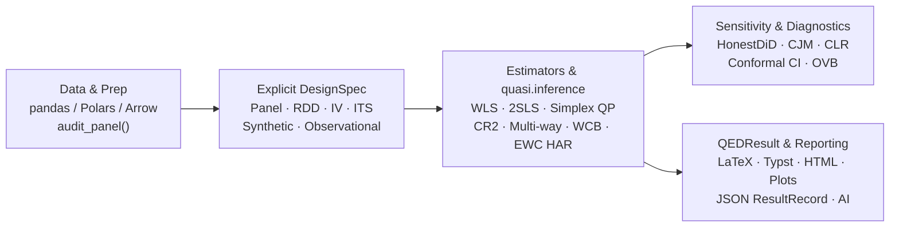

<div align="center">

# Quasi (`quasi-qed`)

**Audited, fail-closed quasi-experimental econometrics in Python.**

[](https://www.python.org/)
[](LICENSE)
[](docs/release-readiness.md)
[](pyproject.toml)
[](src/quasi/py.typed)

*Difference-in-Differences · Regression Discontinuity · Instrumental Variables · Interrupted Time Series · Synthetic Control & SDiD · Observational ATT · Power Analysis · Publication Reporting*

[Interactive HTML Tutorial](docs/tutorial/index.html) · [Quickstart](#quickstart) · [Estimator Matrix](#estimator--capability-matrix) · [Validation Policy](#validation--epistemic-honesty) · [Code Review](docs/code-review.md)

</div>

---

> [!IMPORTANT]
> **Pre-v1.0 Release-Readiness Notice:** All estimator families remain **experimental** pending execution of the external R/Python reference parity suite (`did`, `DRDID`, `rdrobust`, `synthdid`, `linearmodels`) and independent statistical review. See the live ten-estimator [release-readiness matrix](docs/release-readiness.md). Passing unit tests and internal Monte Carlo checks are **not** statistical certification, and diagnostics never prove causal identification.

## Why Quasi?

Most applied causal inference workflows in Python stitch together ad-hoc scripts, silently drop missing rows, omit finite-sample corrections, or fabricate standard errors where asymptotic theory breaks down. **Quasi** is designed around four engineering and econometric principles:

1. **Explicit, immutable designs (`DesignSpec`)** — Declare column roles, control groups, error models, and missing-data policies up front (`PanelDesign`, `RDDDesign`, `IVDesign`, `ITSDesign`, `SyntheticDesign`, `ObservationalDesign`). Invalid combinations fail immediately rather than guessing silently.
2. **Frontier econometrics on a 3-dependency core** — Every core estimator, inference primitive, sensitivity test, power calculator, and LaTeX/Typst/Markdown/HTML renderer runs on **`numpy`, `scipy`, and `pandas` alone**. Heavy optional extras (`matplotlib`, `rich`, `polars`, `scikit-learn`) are imported lazily only when invoked.
3. **Fail-closed statistical honesty** — Missing values raise by default (`missing_policy="raise"`), rank/overlap/support violations abort cleanly, and uncalibrated standard errors (e.g., classic SCM, SDiD, k-NN PSM primary SE, cross-fitted IPW) serialize explicitly as `None` rather than inventing numbers.
4. **End-to-end research workflow** — Move seamlessly from pre-flight panel audits (`audit_panel`) and ex-ante power (`did_mde`, `rdd_mde`, `simulate_power`) to estimation, sensitivity analysis (`HonestDiD`, `CJM density`, `Effective F`/`CLR`, `CWZ conformal`, `Cinelli–Hazlett OVB`), publication tables (`AER` LaTeX, `Nature`, `Typst`, `Markdown`, `HTML`), and machine-readable JSON provenance (`ResultRecord`).



---

## Estimator & Capability Matrix

| Design Family | Estimators & Specs | Modern Econometric Capabilities | Inference, Sensitivity & Diagnostics | Status |
|---|---|---|---|---|
| **Difference-in-Differences** | `StaggeredDiD`<br>`PanelDesign` | Callaway–Sant'Anna (2021) group-time ATT (`never_treated` / `not_yet_treated`, anticipation, universal/varying base), traditional DR & **Improved DR** (Sant'Anna & Zhao 2020 IPT + WLS) | Cohort/calendar/event aggregations, unconditional cohort-share SE, unit & coarse cluster IF, multiplier simultaneous bands, **HonestDiD** (`sensitivity_analysis()`, Rambachan & Roth 2023) | Experimental *(R `did`/`DRDID` parity pending)* |
| **Regression Discontinuity** | `SharpRDD`, `FuzzyRDD`<br>`Discontinuity`, `RDDDesign` | Local polynomial ($p=1,2$), **native scale-invariant CCT `mserd`/`cerrd`** selectors, optional `rdrobust` delegation, donut-hole & covariate placebo grids | Conventional & robust bias-corrected (RBC), **CCT $J=3$ nearest-neighbor VCE** (`vce="nn"`) & HC1–HC3, **CJM (2020) density continuity test**, **Feir–Lemieux–Marmer weak-IV Fuzzy RD AR test** | Experimental *(R/Py `rdrobust` parity pending)* |
| **Instrumental Variables** | `TwoStageLS`<br>`IVDesign` | Single-endogenous 2SLS, **LIML & Fuller($\alpha$)** (`liml()`), auxiliary two-step GMM overidentification | HC0/HC1, CR0/CR1 ($G \ge 10$ guard), **Montiel Olea–Pflueger Effective $F$**, **Lee et al. (2022) $tF$ CI**, **Moreira (2003) CLR**, Anderson–Rubin test, robust & clustered Hansen $J$ | Experimental *(`linearmodels` parity pending)* |
| **Interrupted Time Series** | `InterruptedTimeSeries`<br>`ControlledITS`, `ITSDesign` | Segmented regression, prespecified Fourier seasonality, covariance-aware effect trajectories, **Linden (2015) Controlled ITS** | **Lazarus–Lewis–Stock–Watson (2018) EWC fixed-$b$ HAR**, **Andrews–Monahan prewhitened HAC**, **Harville REML AR(1)**, Prais–Winsten & profile-ML AR(1), in-time placebos | Experimental *(external review pending)* |
| **Synthetic Methods** | `SyntheticDiD`, `SyntheticControl`<br>`AugmentedSCM`, `SyntheticDesign` | Intercept-centered SDiD (with R-style weight sparsification), classic outcome-only SCM, **Ben-Michael–Feller–Rothstein (2021) intercept-shifted Ridge ASCM** | Leave-one-donor-out & in-time placebos, **Chernozhukov–Wüthrich–Zhu (2021) full-series conformal CIs** (`conformal_interval()`); primary point-only SE remains `None` | Experimental *(R `synthdid` parity pending)* |
| **Observational ATT** | `AIPWATT`, `IPWATT`<br>`PropensityScoreMatching`, `ObservationalDesign` | Cross-fitted & Hájek-stabilized AIPW with pluggable `scikit-learn` learners (`[ml]`), normalized IPW, deterministic $k$-NN matching with caliper | Stacked M-estimation HC0, **Abadie–Imbens (2006) Theorem 7 matching SE** (`abadie_imbens_se()`), Love plots, **Cinelli–Hazlett (2020) OVB sensitivity** (`ovb_sensitivity()`) | Experimental *(independent review pending)* |
| **Shared Inference & Power** | `quasi.inference`<br>`quasi.power` | Rank-checked WLS/2SLS, scale- & shift-invariant KKT-checked simplex QP, thin-SVD **CR2 + Satterthwaite df**, **Cameron–Gelbach–Miller multi-way clustering**, **Wild Cluster Bootstrap** | **Burlig–Preonas–Woerman (2020)** AR(1)/covariance panel DiD power (noncentral-$t$), exact CCT boundary-variance RDD power, `synth_feasibility()`, **Monte Carlo `simulate_power()`** | Experimental |

---

## Installation

The provisional package name is `quasi-qed` (import namespace: `quasi`; current development version: `0.2.0.dev0`). Python **3.10–3.14** is supported.

```bash
# Lean core runtime (numpy, scipy, pandas only)
pip install -e .

# Recommended full local setup (plotting, rich tables, Polars, ML learners, validation & tests)
pip install -e ".[all,dev]"
```

<details>
<summary><strong>Optional Extras Reference</strong></summary>

| Extra | Packages | Capability |
|---|---|---|
| *(core)* | `numpy`, `scipy`, `pandas` | All estimators, `quasi.inference`, `quasi.power`, JSON/LaTeX/Typst/Markdown/HTML reporting |
| `[plot]` | `matplotlib>=3.7` | Event-study, discontinuity, ITS trajectory, synthetic gap, Love, and power plots |
| `[report]` | `rich>=13` | Styled terminal summary cards and multi-model comparison tables |
| `[polars]` | `polars`, `pyarrow` | Zero-copy eager & lazy Polars/Arrow DataFrame ingestion |
| `[ml]` | `scikit-learn>=1.3` | Pluggable ML nuisance learners for cross-fitted `AIPWATT` |
| `[ai]` | *(stdlib only)* | Optional LLM interpretation adapters (OpenAI, Anthropic, Gemini, Ollama, offline Mock) |
| `[validation]` | `statsmodels`, `pyarrow` | Independent real-data reference verification & Monte Carlo lab |
| `[docs]` | `mkdocs`, `mkdocs-material` | Strict documentation site build (`mkdocs build --strict`) |
| `[dev]` | `pytest`, `hypothesis`, `ruff`, `mypy`, `build`, `twine`, `pip-audit`, … | Testing, property checks, linting, typing, and packaging |

</details>

---

## Quickstart

### 1. Staggered DiD with Improved DR & HonestDiD Sensitivity

```python
import quasi
from quasi.prep.audit import audit_panel

# Pre-flight structural panel audit (duplicates, balance, rollout type, cluster count)
health = audit_panel(df, unit="hospital", time="year", treatment="treated")

spec = quasi.PanelDesign(
    outcome="score",
    unit="hospital",
    time="year",
    first_treated="first_treated",
    covariates=("case_mix",),
    est_method="dr_improved",        # Sant'Anna & Zhao (2020) IPT + WLS
    control_group="not_yet_treated",
    base_period="universal",
)
did_res = quasi.estimate(df, design=spec)
print(did_res.summary())

# Rambachan & Roth (2023) HonestDiD sensitivity under bounded parallel-trends violations
honest = did_res.sensitivity_analysis(method="relative_magnitudes", m_grid=[0.0, 0.5, 1.0, 1.5])
print("Breakdown M_bar:", honest.breakdown_value)
```

### 2. Sharp RDD with Native CCT `mserd`, Robust Bias Correction & CJM Density Test

```python
rdd_res = quasi.estimate(
    df_rd,
    design=quasi.RDDDesign(
        outcome="gpa",
        running_var="score",
        cutoff=75.0,
        bandwidth="mserd",           # Native scale-invariant CCT MSE-optimal selector
        inference="bias_corrected",  # Robust bias correction (p+1 pilot)
        vce="nn",                    # CCT J=3 nearest-neighbor variance
    ),
)
cjm = rdd_res.cjm_density()          # Cattaneo, Jansson & Ma (2020) density test
```

<details>
<summary><strong>More Examples: IV (Effective F / LIML / CLR), ITS (EWC HAR), Synthetic (ASCM + Conformal), Observational & Reporting</strong></summary>

```python
# 3. Instrumental Variables — Effective F, LIML/Fuller & Moreira CLR
iv_res = quasi.estimate(
    df_iv,
    design=quasi.IVDesign(
        outcome="wage", endogenous="schooling", instruments=("z1", "z2"),
        covariates=("experience",), covariance="HC1",
    ),
)
eff = iv_res.effective_f()
liml = iv_res.liml(fuller_alpha=1.0)
clr = iv_res.clr_test(null_effect=0.0)

# 4. Interrupted Time Series — EWC Fixed-b HAR with Fourier Seasonality
its_res = quasi.estimate(
    df_its,
    design=quasi.ITSDesign(
        outcome="admissions", time="month", intervention_date=48,
        error_model="ewc", seasonal_period=12, seasonal_harmonics=1,
    ),
)

# 5. Intercept-Shifted Ridge Augmented SCM + CWZ Conformal CI
ascm_res = quasi.AugmentedSCM(
    df_syn, outcome="y", unit="state", time="year",
    treated_unit="TargetState", intervention_time=2015, treatment="treated",
).fit()
conformal_ci = ascm_res.conformal_interval(alpha=0.10)

# 6. Cross-Fitted Stabilized AIPW + Cinelli-Hazlett OVB Sensitivity
aipw_res = quasi.estimate(
    df_obs,
    design=quasi.ObservationalDesign(
        outcome="earnings", treatment="training", covariates=("age", "prior_earn"),
        estimator="aipw", n_splits=5, stabilized=True,
    ),
)
ovb = aipw_res.ovb_sensitivity(q=1.0, alpha=0.05)

# 7. Multi-Model Publication Tables & Audited JSON Provenance
table = quasi.compare_models({"DiD": did_res, "RDD": rdd_res, "IV": iv_res, "ASCM": ascm_res})
print(table.to_latex())    # AER booktabs LaTeX (also .to_typst(), .to_markdown(), .to_html())
record = quasi.ResultRecord.from_json(did_res.to_json())
```

</details>

---

## Interactive Multi-Page HTML Tutorial

A complete, offline-ready **8-chapter interactive HTML tutorial** with live-executed outputs, interactive design selector wizard, tabbed LaTeX/Typst/Markdown/HTML/JSON panels, and 6 high-DPI plots lives in [`docs/tutorial/index.html`](docs/tutorial/index.html):

| Chapter | Topics Covered |
|---|---|
| [00 · Overview & Quickstart](docs/tutorial/index.html) | Architecture, interactive design selector, installation & `DesignSpec` |
| [01 · Difference-in-Differences](docs/tutorial/did.html) | `audit_panel`, Callaway–Sant'Anna, Improved DR, Event Study plot & HonestDiD |
| [02 · Regression Discontinuity](docs/tutorial/rdd.html) | Sharp & Fuzzy RDD, native `mserd`/RBC/NN, CJM density, donut & weak-IV AR |
| [03 · Instrumental Variables](docs/tutorial/iv.html) | 2SLS, Effective $F$, Lee et al. $tF$ CIs, LIML/Fuller, Moreira CLR & Hansen $J$ |
| [04 · Interrupted Time Series](docs/tutorial/its.html) | NW-HAC vs. Prewhitened HAC vs. EWC HAR vs. REML AR(1), seasonality & Controlled ITS |
| [05 · Synthetic Control & SDiD](docs/tutorial/synthetic.html) | Classic SCM, SDiD + sparsification, Ridge Augmented SCM & CWZ conformal CIs |
| [06 · Observational ATT & PSM](docs/tutorial/observational.html) | Stabilized/cross-fitted AIPW, IPW, PSM + Abadie–Imbens SE, Love plot & OVB |
| [07 · Inference, Power & Reporting](docs/tutorial/inference-power-reporting.html) | CR2/multi-way/WCB/EWC, BPW/CCT/`simulate_power`, multi-format tables & offline AI |

Regenerate all tutorial pages and figures locally anytime with `MPLBACKEND=Agg python examples/build_tutorial.py`.

---

## Validation & Epistemic Honesty

Quasi enforces strict separation between unit tests, internal Monte Carlo calibration, and external cross-language reference parity:

```bash
# 1. Full unit, contract, algebraic-invariant, review-regression & frontier suite (524 tests)
python -m pytest -q

# 2. Verify pinned Statsmodels real-data reference fixtures (no Quasi-generated goldens)
python -m validation.generate_references --check
python -m pytest -q tests/parity tests/validation

# 3. Exploratory finite-sample calibration check across frontier upgrades (not certification)
python -m validation.frontier_calibration_check

# 4. Machine-checkable release-readiness audit (intentionally blocks until R parity & review complete)
python -m validation.release_readiness --output validation/reports/v1_release_readiness.json
python -m validation.gate --strict
```

- **External R & Python parity workflow:** [`.github/workflows/external-parity-suite.yml`](.github/workflows/external-parity-suite.yml) runs `validation.external_suite` against CRAN R packages (`did`, `DRDID`, `rdrobust`, `synthdid`) and Python (`linearmodels`, `rdrobust`) with SHA-256 fixture verification.
- **No causal certification from diagnostics:** `ResultRecord.identification_status` is explicitly `"not_established"`; diagnostics screen for observable violations only.

---

## Documentation, Governance & Citation

- **Docs & ADRs:** [Documentation Home](docs/index.md) · [Development Guide](docs/development.md) · [Design API](docs/design-api.md) · [Inference Core](docs/inference-core.md) · [Validation Lab](docs/validation.md) · [Full Code Review](docs/code-review.md) · [Release Readiness](docs/release-readiness.md)
- **Project Governance:** [Changelog](CHANGELOG.md) · [Contributing](CONTRIBUTING.md) · [Security Policy](SECURITY.md) · [Code of Conduct](CODE_OF_CONDUCT.md)

### Citation

If you use Quasi in research or teaching, please cite it via [CITATION.cff](CITATION.cff):

```bibtex
@software{quasi_qed,
  title   = {Quasi (quasi-qed): Audited Quasi-Experimental Econometrics in Python},
  author  = {Quasi contributors},
  version = {0.2.0.dev0},
  license = {MIT}
}
```

## License

MIT License — see [LICENSE](LICENSE) for details.
